# RAG Multimodal

Sistema RAG para manuales técnicos en PDF (texto, tablas, diagramas e imágenes) con arquitectura hexagonal.

El proyecto está construido por fases. **HU-01** deja el scaffold, la configuración por ambiente, el logging estructurado, el endpoint de salud, el worker base y el pipeline de calidad. **HU-02** añade el entorno contenerizado con healthchecks, frontend placeholder y Ollama como perfil opcional. Las historias posteriores completan la ingesta multimodal, la recuperación híbrida y el cliente web.

## Arquitectura

```mermaid
%% Generated by https://gitdiagram.com/jhonnydiaz4753/rag-multimodal
flowchart TD

subgraph group_client["Web client"]
  node_web["Web UI<br/>[App.js]"]
  node_webapi["HTTP client<br/>[Api.js]"]
end

subgraph group_entry["API and workers"]
  node_api["FastAPI app<br/>[app.py]"]
  node_upload_route["Upload route<br/>[documents.py]"]
  node_query_routes["Query and ask routes<br/>[query.py]"]
  node_jobs_route["Job status route<br/>[jobs.py]"]
  node_worker["Celery task<br/>[tasks.py]"]
end

subgraph group_usecases["Application and domain"]
  node_upload_uc["Upload use case<br/>[upload_document.py]"]
  node_process_uc["Document processing"]
  node_chunker["Layout chunking<br/>[chunking.py]"]
  node_answer_uc["Answer retrieval<br/>[answer_question.py]"]
  node_domain["Domain entities<br/>[entities.py]"]
end

subgraph group_adapters["Infrastructure adapters"]
  node_parser["PDF parsing<br/>[pymupdf_parser.py]"]
  node_pdf_store[("PDF storage")]
  node_image_store[("Image storage")]
  node_jobs_store[("Job repository<br/>[redis_job_repo.py]")]
  node_embed["Embedding adapters"]
  node_vector[("Qdrant store<br/>[qdrant_store.py]")]
  node_llm["LLM adapters<br/>[ollama_llm.py]"]
end

node_user(("Manuals user"))
node_ai_provider["Ollama / OpenAI"]
node_redis[("Redis")]
node_qdrant[("Qdrant")]

node_user -->|"uses"| node_web
node_web -->|"calls"| node_webapi
node_webapi -.->|"requests"| node_api
node_api -->|"registers"| node_upload_route
node_api -->|"registers"| node_query_routes
node_api -->|"registers"| node_jobs_route
node_upload_route -->|"invokes"| node_upload_uc
node_upload_uc -.->|"saves PDF"| node_pdf_store
node_upload_uc -.->|"creates job"| node_jobs_store
node_upload_uc -.->|"dispatches task"| node_worker
node_worker -->|"executes"| node_process_uc
node_process_uc -->|"parses PDF"| node_parser
node_parser -->|"stores images"| node_image_store
node_process_uc -->|"chunks layout"| node_chunker
node_process_uc -.->|"embeds chunks"| node_embed
node_process_uc -.->|"indexes chunks"| node_vector
node_process_uc -.->|"updates progress"| node_jobs_store
node_jobs_route -.->|"reads status"| node_jobs_store
node_query_routes -->|"invokes"| node_answer_uc
node_answer_uc -->|"embeds query"| node_embed
node_answer_uc -->|"searches context"| node_vector
node_answer_uc -->|"generates answer"| node_llm
node_answer_uc -->|"finds image"| node_image_store
node_embed -.->|"requests vectors"| node_ai_provider
node_llm -.->|"requests generation"| node_ai_provider
node_vector -.->|"reads and writes"| node_qdrant
node_jobs_store -.->|"reads and writes"| node_redis
node_process_uc -->|"uses entities"| node_domain
node_answer_uc -->|"builds answer"| node_domain

click node_web "https://github.com/jhonnydiaz4753/rag-multimodal/blob/main/frontend/js/App.js"
click node_webapi "https://github.com/jhonnydiaz4753/rag-multimodal/blob/main/frontend/js/Api.js"
click node_api "https://github.com/jhonnydiaz4753/rag-multimodal/blob/main/backend/src/api/app.py"
click node_upload_route "https://github.com/jhonnydiaz4753/rag-multimodal/blob/main/backend/src/api/routes/documents.py"
click node_query_routes "https://github.com/jhonnydiaz4753/rag-multimodal/blob/main/backend/src/api/routes/query.py"
click node_jobs_route "https://github.com/jhonnydiaz4753/rag-multimodal/blob/main/backend/src/api/routes/jobs.py"
click node_worker "https://github.com/jhonnydiaz4753/rag-multimodal/blob/main/backend/src/workers/tasks.py"
click node_upload_uc "https://github.com/jhonnydiaz4753/rag-multimodal/blob/main/backend/src/application/upload_document.py"
click node_process_uc "https://github.com/jhonnydiaz4753/rag-multimodal/blob/main/backend/src/application/process_document.py"
click node_parser "https://github.com/jhonnydiaz4753/rag-multimodal/blob/main/backend/src/infrastructure/parsers/pymupdf_parser.py"
click node_chunker "https://github.com/jhonnydiaz4753/rag-multimodal/blob/main/backend/src/application/chunking.py"
click node_answer_uc "https://github.com/jhonnydiaz4753/rag-multimodal/blob/main/backend/src/application/answer_question.py"
click node_domain "https://github.com/jhonnydiaz4753/rag-multimodal/blob/main/backend/src/domain/entities.py"
click node_pdf_store "https://github.com/jhonnydiaz4753/rag-multimodal/blob/main/backend/src/infrastructure/storage/local_document_storage.py"
click node_image_store "https://github.com/jhonnydiaz4753/rag-multimodal/blob/main/backend/src/infrastructure/images/local_image_storage.py"
click node_jobs_store "https://github.com/jhonnydiaz4753/rag-multimodal/blob/main/backend/src/infrastructure/jobs/redis_job_repo.py"
click node_embed "https://github.com/jhonnydiaz4753/rag-multimodal/blob/main/backend/src/infrastructure/embeddings/ollama_embeddings.py"
click node_vector "https://github.com/jhonnydiaz4753/rag-multimodal/blob/main/backend/src/infrastructure/vector_stores/qdrant_store.py"
click node_llm "https://github.com/jhonnydiaz4753/rag-multimodal/blob/main/backend/src/infrastructure/llm/ollama_llm.py"

classDef toneNeutral fill:#f8fafc,stroke:#334155,stroke-width:1.5px,color:#0f172a
classDef toneBlue fill:#dbeafe,stroke:#2563eb,stroke-width:1.5px,color:#172554
classDef toneAmber fill:#fef3c7,stroke:#d97706,stroke-width:1.5px,color:#78350f
classDef toneMint fill:#dcfce7,stroke:#16a34a,stroke-width:1.5px,color:#14532d
classDef toneRose fill:#ffe4e6,stroke:#e11d48,stroke-width:1.5px,color:#881337
classDef toneIndigo fill:#e0e7ff,stroke:#4f46e5,stroke-width:1.5px,color:#312e81
classDef toneTeal fill:#ccfbf1,stroke:#0f766e,stroke-width:1.5px,color:#134e4a
class node_web,node_webapi,node_user toneBlue
class node_api,node_upload_route,node_query_routes,node_jobs_route,node_worker,node_redis,node_qdrant toneAmber
class node_upload_uc,node_process_uc,node_chunker,node_answer_uc,node_domain toneMint
class node_parser,node_pdf_store,node_image_store,node_jobs_store,node_embed,node_vector,node_llm toneRose
class node_ai_provider toneIndigo
```



Regla de dependencias:

- `domain`: entidades y reglas de negocio. No importa FastAPI, Celery ni clientes externos.
- `application`: casos de uso y puertos (interfaces) que necesita el negocio.
- `infrastructure`: adaptadores concretos (Qdrant, Redis, LLM, logging).
- `api` y `workers`: adaptadores de entrada; traducen HTTP o mensajes a casos de uso.

La inyección de dependencias se apoya en `FastAPI.Depends` y en el contenedor de settings. Los adaptadores externos se podrán intercambiar sin modificar el dominio.

### Dominio y puertos

- `backend/src/domain/entities.py`: entidades y value objects del núcleo (`Document`, `Chunk`, `BBox`, `ImageRef`, `Job`, `Answer` y el resto de value objects de apoyo: `Page`, `TextBlock`, `TableBlock`, `Source`, `RetrievedChunk`).
- `backend/src/application/ports/`: puertos de salida, un módulo por contrato (`llm.py`, `embeddings.py`, `vector_store.py`, `document_parser.py`, `job_repository.py`, `image_storage.py`).

Los puertos se aíslan con ABCs explícitos. Los puertos de red (LLM, embeddings, Qdrant) son `async`; los de CPU/filesystem (parser, imágenes) y los repositorios que consume Celery son síncronos.

La pureza del dominio queda verificada en `tests/unit/test_architecture.py`: un test con `ast` inspecciona los imports y falla si el dominio usa una librería externa o si los puertos se acoplan a la infraestructura.

### Chunking por layout

`backend/src/application/chunking.py` construye chunks por sección y subsección. El límite predeterminado es de 512 tokens léxicos (palabras y signos de puntuación), con hasta 32 tokens de solapamiento. Cada tabla se mantiene completa en un chunk propio, aunque exceda el límite. El texto de cada chunk incluye su `heading_path` como prefijo y `Chunk.payload` expone los metadatos de trazabilidad serializables. Las imágenes se asocian solo a chunks de la misma página, por distancia vertical entre bboxes; si la página contiene un pie `Figura X`, se prefiere el chunk que lo contiene.

**Por qué esta estrategia:** un corte por tamaño fijo rompe tablas y separa encabezados de su contenido; el chunking por layout conserva la jerarquía del manual y permite citar página y sección. El límite de 512 tokens con 32 de solapamiento equilibra contexto y precisión de recuperación. Las tablas se mantienen atómicas para no perder filas ni relaciones, aunque excedan el límite. Las imágenes se asocian por página y distancia vertical para evitar vincular una figura al texto equivocado.

### Pipeline de ingesta en segundo plano

`POST /documents` encola `process_document_task` en Celery y devuelve sin ejecutar el pipeline pesado en la API. El worker procesa cada PDF en las etapas `parsing`, `chunking`, `embedding` e `indexing`. Los embeddings se generan en lotes de hasta 8 chunks; durante esa etapa Redis actualiza el progreso de 50 a 74 % para que documentos grandes no dependan de una única petición extensa al proveedor. Al indexar, el progreso pasa a 75 % y termina en 100 %. Si falla una etapa, el job queda en estado `failed` con el tipo y el motivo del error.

`GET /jobs/{job_id}` consulta en Redis el estado, la etapa y el porcentaje de avance de una tarea; devuelve `404` cuando el job no existe.

`POST /query` recibe `question`, `top_k` opcional y `doc_ids` opcional. Recupera contexto con búsqueda híbrida, devuelve `{answer, sufficient_info, sources[]}` y solo permite citar chunks realmente recuperados. Si no hay chunks que superen `MIN_RELEVANCE_SCORE`, responde que no hay información suficiente sin invocar el LLM. El proveedor de generación se selecciona con `LLM_PROVIDER` (`ollama` u `openai`).

`POST /ask` acepta `question`, un `history` opcional de hasta 20 mensajes `user`/`assistant`, `top_k` y `doc_ids`. Devuelve `{answer, sources:[{file, page}], image?}`; si un chunk citado tiene una imagen asociada, devuelve la imagen más cercana al texto como data URI base64. El historial ayuda a interpretar seguimientos, pero no se considera evidencia para responder.

Las llamadas HTTP a embeddings y OpenAI tienen timeout explícito (5 s de conexión y 30 s de lectura/escritura); la generación con Ollama permite hasta 180 s para inferencia local. Todas reintentan hasta tres veces ante HTTP 429, HTTP 5xx o timeouts, con backoff exponencial y jitter. El proxy y el cliente web permiten hasta 300 s para completar una respuesta local. Otros errores HTTP no se reintentan. Qdrant y Redis también tienen timeouts de red explícitos.

El adaptador LLM usa un circuit breaker por proveedor/modelo: se abre tras cinco fallos transitorios consecutivos, rechaza llamadas durante 30 s y luego permite un único sondeo de recuperación. Los logs de consultas y reintentos heredan el `request_id` de la API; el worker propaga el ID de tarea como `request_id` y añade `job_id` a los eventos de ingesta.

## Estructura

```text
pruebaTecnica/
├── backend/
│   ├── src/
│   │   ├── config/           # Settings tipados con pydantic-settings
│   │   ├── domain/           # Núcleo sin dependencias de frameworks
│   │   ├── application/      # Casos de uso y puertos
│   │   ├── infrastructure/   # Adaptadores (Qdrant, Redis, LLM, imágenes, tareas, logging)
│   │   ├── api/              # FastAPI, middleware, rutas y DI
│   │   └── workers/          # Celery
│   ├── tests/                # Tests unitarios
│   ├── Dockerfile
│   ├── pyproject.toml
│   ├── requirements.txt
│   └── requirements-dev.txt
├── frontend/                 # UI de consulta, carga de PDFs y progreso de jobs
├── docker-compose.yml
├── .env.example
└── Makefile
```

## Inicio rápido con Docker

En un clon limpio, el stack base se levanta con un solo comando:

```bash
docker compose up --build
```

`.env` es opcional: Compose aplica valores por defecto para las URLs internas y los modelos. Si quieres personalizar proveedores, modelos o límites, copia `.env.example` a `.env` antes de arrancar; también puedes usar `make up`, que crea `.env` si no existe.

El stack base levanta `api`, `worker`, `redis`, `qdrant` y `frontend`. Es rápido y sirve para validar health/UI, pero **no incluye Ollama**: sin proveedor de embeddings/LLM, la ingesta y las consultas RAG fallan. Para el flujo completo:

```bash
docker compose --profile ollama up --build
```

o `make up-full` (alias: `make up-ai`).

Esto añade `ollama` y `ollama-init`; este último descarga `LLM_MODEL`, `EMBEDDING_MODEL` y, si aplica, `VISION_MODEL`. La primera ejecución tarda varios minutos por la descarga de modelos.

Verifica:

```bash
curl http://localhost:8000/health
curl http://localhost:3000
```

La API y el worker comparten el volumen `app_data` en `/data`; Docker Compose fija `DATA_DIR` y `UPLOAD_DIR` a rutas absolutas en ese volumen para que los archivos subidos e imágenes estén disponibles en ambos contenedores. El endpoint `/health` es una sonda de liveness: no depende de Redis, Qdrant ni Ollama.

Para ejecutar el frontend fuera de Docker, sirve el directorio `frontend` con un servidor estático y configura la URL de API en **Conexión** como `http://localhost:8000`. Si el navegador bloquea solicitudes por CORS, sirve la UI con Nginx/Docker Compose, que proxyfica `/api` al backend.

### Healthchecks

| Servicio | Comprobación |
|---|---|
| `redis` | `redis-cli ping` |
| `qdrant` | Conexión TCP al puerto `6333` (la imagen no incluye `curl`/`wget`) |
| `api` | `GET /health` |
| `worker` | `celery inspect ping` al propio worker |
| `frontend` | `wget` a `/` |
| `ollama` | `ollama list` (solo con el perfil) |
| `ollama-init` | Servicio one-shot: se valida por su código de salida 0 |

Abre <http://localhost:3000> para probar la UI conectada al backend. El modo demo está desactivado por defecto; en Docker la interfaz usa el proxy `/api` de Nginx y envía el historial, filtro por documento e imagen al endpoint `/ask`. En **Conexión** puedes cambiar la URL de API o activar el modo demo. La lista de documentos conserva el `document_id` devuelto al subir el PDF para filtrar consultas correctamente.

`docker compose ps` debe mostrar todos los servicios de larga duración en estado `healthy`.

## Desarrollo local

Se requiere un Python **nativo de Windows** (python.org, Microsoft Store o `py`), no el de MSYS2/Git Bash. Un Python MSYS2/MINGW genera un layout POSIX (`bin/`) y no puede usar las ruedas binarias de PyPI, por lo que pip intenta compilar todo desde fuente y falla.

Requisitos: Python 3.12 o superior. El proyecto usa 3.12 en Docker/CI; localmente se ha validado con 3.13.

```powershell
cd backend
python -m venv .venv
. .\.venv\Scripts\Activate.ps1
python -m pip install -r requirements-dev.txt
uvicorn src.api.main:app --reload --no-access-log
```

En otra terminal:

```powershell
curl.exe http://localhost:8000/health
```

El `.env` de la raíz contiene los hostnames de Docker Compose (`redis`, `qdrant`, `ollama`). Para ejecutar la API fuera de Compose, cambia esos valores a `localhost` en tu `.env` o pásalos como variables de entorno:

```dotenv
REDIS_URL=redis://localhost:6379/0
QDRANT_URL=http://localhost:6333
OLLAMA_BASE_URL=http://localhost:11434
DATA_DIR=./data
```

## Configuración por ambiente

La configuración se carga con `pydantic-settings` en este orden de prioridad:

1. Variables de entorno del proceso.
2. Archivo `.env` de la raíz del repositorio.
3. Valores por defecto de `Settings`.

`.env` está ignorado por git; `.env.example` es la plantilla versionada. Nunca se deben commitear secretos.

| Variable | Default | Descripción |
|---|---|---|
| `APP_NAME` | `rag-multimodal` | Nombre del servicio |
| `APP_VERSION` | `0.1.0` | Versión expuesta en `/health` |
| `APP_ENV` | `development` | `development`, `test` o `production` |
| `DEBUG` | `false` | Modo debug de FastAPI |
| `LOG_LEVEL` | `INFO` | Nivel de logging |
| `LOG_FORMAT` | `json` | `json` o `console` |
| `DATA_DIR` | `./data` (ejemplo: `/data`) | Directorio de datos |
| `UPLOAD_DIR` | `./data/uploads` | Directorio de PDFs subidos |
| `MAX_UPLOAD_MB` | `50` | Tamaño máximo del PDF recibido |
| `JOB_TTL_SECONDS` | `86400` | Tiempo de retención de jobs en Redis |
| `REDIS_URL` | `redis://localhost:6379/0` | Broker y backend de Celery |
| `QDRANT_URL` | `http://localhost:6333` | URL de Qdrant |
| `QDRANT_COLLECTION` | `manuals` | Colección vectorial |
| `MIN_RELEVANCE_SCORE` | `0.01` | Umbral mínimo del score RRF para devolver resultados (0–1) |
| `SPARSE_EMBEDDING_MODEL` | `Qdrant/bm25` | Modelo sparse FastEmbed para búsqueda léxica |
| `OLLAMA_BASE_URL` | `http://localhost:11434` | URL de Ollama |
| `LLM_PROVIDER` | `ollama` | `ollama` u `openai` |
| `LLM_MODEL` | `qwen2.5:7b-instruct` | Modelo generativo |
| `EMBEDDING_PROVIDER` | `ollama` | Proveedor de embeddings: `ollama` u `openai` |
| `EMBEDDING_MODEL` | `bge-m3` | Modelo de embeddings |
| `EMBEDDING_DIM` | `1024` | Dimensión de los embeddings |
| `VISION_MODEL` | `qwen2.5vl:7b` | Modelo de visión |
| `ENABLE_IMAGE_CAPTIONING` | `false` | Activa el captioning de imágenes |
| `OPENAI_API_KEY` | vacío | Obligatoria si `LLM_PROVIDER=openai` o `EMBEDDING_PROVIDER=openai` |
| `OPENAI_BASE_URL` | vacío | Base URL opcional para un proveedor compatible |

Reglas de validación:

- En `production`, `DEBUG` debe ser `false` y `LOG_FORMAT` debe ser `json`.
- Si `LLM_PROVIDER=openai` o `EMBEDDING_PROVIDER=openai`, `OPENAI_API_KEY` es obligatoria.
- El almacén vectorial crea vectores densos (`dense`) y sparse BM25 (`sparse`) en Qdrant; los sparse se generan con FastEmbed.
- La búsqueda híbrida fusiona ambos rankings mediante RRF y descarta resultados por debajo de `MIN_RELEVANCE_SCORE`; los chunks recuperados conservan sus `image_ids`.
- `REDIS_URL` debe usar `redis://` o `rediss://`; las URLs HTTP deben incluir esquema y host.

## API

```http
GET /health
```

```json
{
  "status": "ok",
  "service": "rag-multimodal",
  "version": "0.1.0",
  "environment": "development"
}
```

Todas las respuestas incluyen la cabecera `X-Request-ID`. Si el cliente la envía con un valor válido (8-64 caracteres alfanuméricos, `.`, `_` o `-`), se respeta; en caso contrario se genera un UUID.

En `production` se desactivan `/docs`, `/redoc` y `/openapi.json`.

## Logging estructurado

El logging usa `structlog` integrado con `logging`. En formato JSON cada línea incluye, como mínimo:

```json
{
  "timestamp": "2026-10-30T15:00:00.000000Z",
  "level": "info",
  "logger": "src.api.middleware",
  "event": "request.completed",
  "request_id": "2f1c9e0d4b7a4f3c9a1e8d2b6c5f7a90",
  "method": "GET",
  "path": "/health",
  "status_code": 200,
  "duration_ms": 1.23
}
```

- `LOG_FORMAT=json` para producción y agregadores.
- `LOG_FORMAT=console` para desarrollo local.
- El access log nativo de Uvicorn se desactiva con `--no-access-log`; el middleware emite el log de acceso estructurado.
- Los logs de Uvicorn, Celery y librerías externas pasan por el mismo formatter.

## Tests y lint

```powershell
cd backend
python -m pytest -q
ruff check src tests
ruff format --check src tests
```

También están disponibles los atajos del `Makefile`:

```bash
make up        # stack base (crea .env si falta)
make up-full   # stack completo + Ollama + descarga de modelos
make up-ai     # alias de up-full
make ps        # estado y salud de los servicios
make down     # detiene todo, incluido el perfil ollama
make test
make lint
make fmt
```

## CI

`.github/workflows/ci.yml` ejecuta en cada push y pull request:

1. Instalación de dependencias con Python 3.12.
2. `ruff check src tests`.
3. `ruff format --check src tests`.
4. `pytest -q`.
5. `docker compose config` para validar el Compose base y el perfil `ollama`.

## Decisiones técnicas

- **Arquitectura hexagonal** para aislar dominio y casos de uso de FastAPI, Celery y proveedores externos.
- **Chunking por layout** en lugar de tamaño fijo: conserva encabezados, tablas y trazabilidad a página; el límite de 512 tokens con 32 de solapamiento equilibra contexto y precisión. Las tablas son atómicas y las imágenes se asocian por página y distancia vertical (ver [Chunking por layout](#chunking-por-layout)).
- **Búsqueda híbrida densa + BM25 con RRF** porque los manuales combinan lenguaje natural y términos técnicos exactos; RRF fusiona rankings sin calibrar puntuaciones entre proveedores. Alternativa descartada: solo búsqueda densa, que pierde coincidencias literales.
- **Qdrant** como base vectorial por su soporte nativo de vectores densos y sparse y su despliegue sencillo en Docker. Alternativas: pgvector o FAISS; se prioriza la integración híbrida y la operación con Compose.
- **FastAPI** por su integración con Pydantic, su sistema de dependencias y su documentación OpenAPI.
- **Celery + Redis** para desacoplar la ingesta pesada del hilo HTTP y persistir el progreso; alternativa: `BackgroundTasks` de FastAPI, que no sobrevive reinicios ni escala a workers.
- **Ollama** para modelos locales y **OpenAI** como alternativa configurable; el perfil `ollama` es opcional para que el stack base arranque rápido, pero el flujo RAG completo lo requiere.
- **structlog** para logs JSON con contexto de petición y compatibilidad con logs de terceros.
- **pydantic-settings** para configuración tipada, validada y por ambiente.
- **Ruff + pytest + GitHub Actions** como red de seguridad mínima desde el primer commit.
- **Docker no-root** para reducir la superficie de ataque del contenedor.

## Funcionalidades implementadas

- Ingesta asíncrona de PDF y tracking de estado por `job_id`.
- Extracción multimodal de texto, tablas e imágenes con bounding boxes.
- Chunking por layout e indexación híbrida en Qdrant.
- Recuperación híbrida y generación defensiva con contexto visual.
- Cliente web con chat, Markdown y fuentes citadas.
