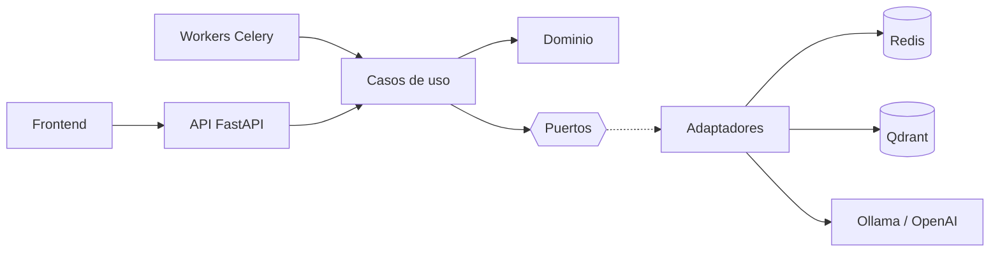

# RAG Multimodal

Sistema RAG para manuales técnicos en PDF (texto, tablas, diagramas e imágenes) con arquitectura hexagonal.

El proyecto está construido por fases. **HU-01** deja el scaffold, la configuración por ambiente, el logging estructurado, el endpoint de salud, el worker base y el pipeline de calidad listos para las siguientes historias.

## Arquitectura



Regla de dependencias:

- `domain`: entidades y reglas de negocio. No importa FastAPI, Celery ni clientes externos.
- `application`: casos de uso y puertos (interfaces) que necesita el negocio.
- `infrastructure`: adaptadores concretos (Qdrant, Redis, LLM, logging).
- `api` y `workers`: adaptadores de entrada; traducen HTTP o mensajes a casos de uso.

La inyección de dependencias se apoya en `FastAPI.Depends` y en el contenedor de settings. Los adaptadores externos se podrán intercambiar sin modificar el dominio.

## Estructura

```text
backend/
├── src/
│   ├── config/           # Settings tipados con pydantic-settings
│   ├── domain/           # Núcleo sin dependencias de frameworks
│   ├── application/      # Casos de uso y puertos
│   ├── infrastructure/   # Adaptadores (logging por ahora)
│   ├── api/              # FastAPI, middleware, rutas y DI
│   └── workers/          # Celery
├── tests/                # Tests unitarios
├── Dockerfile
├── pyproject.toml
├── requirements.txt
└── requirements-dev.txt
```

## Inicio rápido con Docker

```bash
cp .env.example .env
docker compose up --build
curl http://localhost:8000/health
```

La primera ejecución descarga los modelos de Ollama y puede tardar varios minutos. El endpoint `/health` es una sonda de liveness: no depende de Redis, Qdrant ni Ollama.

## Desarrollo local

Se requiere un Python **nativo de Windows** (python.org, Microsoft Store o `py`), no el de MSYS2/Git Bash. Un Python MSYS2/MINGW genera un layout POSIX (`bin/`) y no puede usar las ruedas binarias de PyPI, por lo que pip intenta compilar todo desde fuente y falla.

Requisitos: Python 3.12 o superior. El proyecto usa 3.12 en Docker/CI; localmente se ha validado con 3.13.

```powershell
cd backend
python -m venv .venv
. .\.venv\Scripts\Activate.ps1
python -m pip install -r requirements-dev.txt
uvicorn src.api.main:app --reload --no-access-log
```

En otra terminal:

```powershell
curl.exe http://localhost:8000/health
```

El `.env` de la raíz contiene los hostnames de Docker Compose (`redis`, `qdrant`, `ollama`). Para ejecutar la API fuera de Compose, cambia esos valores a `localhost` en tu `.env` o pásalos como variables de entorno:

```dotenv
REDIS_URL=redis://localhost:6379/0
QDRANT_URL=http://localhost:6333
OLLAMA_BASE_URL=http://localhost:11434
DATA_DIR=./data
```

## Configuración por ambiente

La configuración se carga con `pydantic-settings` en este orden de prioridad:

1. Variables de entorno del proceso.
2. Archivo `.env` de la raíz del repositorio.
3. Valores por defecto de `Settings`.

`.env` está ignorado por git; `.env.example` es la plantilla versionada. Nunca se deben commitear secretos.

| Variable | Default | Descripción |
|---|---|---|
| `APP_NAME` | `rag-multimodal` | Nombre del servicio |
| `APP_VERSION` | `0.1.0` | Versión expuesta en `/health` |
| `APP_ENV` | `development` | `development`, `test` o `production` |
| `DEBUG` | `false` | Modo debug de FastAPI |
| `LOG_LEVEL` | `INFO` | Nivel de logging |
| `LOG_FORMAT` | `json` | `json` o `console` |
| `DATA_DIR` | `./data` (ejemplo: `/data`) | Directorio de datos |
| `REDIS_URL` | `redis://localhost:6379/0` | Broker y backend de Celery |
| `QDRANT_URL` | `http://localhost:6333` | URL de Qdrant |
| `QDRANT_COLLECTION` | `manuals` | Colección vectorial |
| `OLLAMA_BASE_URL` | `http://localhost:11434` | URL de Ollama |
| `LLM_PROVIDER` | `ollama` | `ollama` u `openai` |
| `LLM_MODEL` | `qwen2.5:7b-instruct` | Modelo generativo |
| `EMBEDDING_MODEL` | `bge-m3` | Modelo de embeddings |
| `EMBEDDING_DIM` | `1024` | Dimensión de los embeddings |
| `VISION_MODEL` | `qwen2.5vl:7b` | Modelo de visión |
| `ENABLE_IMAGE_CAPTIONING` | `false` | Activa el captioning de imágenes |
| `OPENAI_API_KEY` | vacío | Obligatoria si `LLM_PROVIDER=openai` |
| `OPENAI_BASE_URL` | vacío | Base URL opcional para un proveedor compatible |

Reglas de validación:

- En `production`, `DEBUG` debe ser `false` y `LOG_FORMAT` debe ser `json`.
- Si `LLM_PROVIDER=openai`, `OPENAI_API_KEY` es obligatoria.
- `REDIS_URL` debe usar `redis://` o `rediss://`; las URLs HTTP deben incluir esquema y host.

## API

```http
GET /health
```

```json
{
  "status": "ok",
  "service": "rag-multimodal",
  "version": "0.1.0",
  "environment": "development"
}
```

Todas las respuestas incluyen la cabecera `X-Request-ID`. Si el cliente la envía con un valor válido (8-64 caracteres alfanuméricos, `.`, `_` o `-`), se respeta; en caso contrario se genera un UUID.

En `production` se desactivan `/docs`, `/redoc` y `/openapi.json`.

## Logging estructurado

El logging usa `structlog` integrado con `logging`. En formato JSON cada línea incluye, como mínimo:

```json
{
  "timestamp": "2026-10-30T15:00:00.000000Z",
  "level": "info",
  "logger": "src.api.middleware",
  "event": "request.completed",
  "request_id": "2f1c9e0d4b7a4f3c9a1e8d2b6c5f7a90",
  "method": "GET",
  "path": "/health",
  "status_code": 200,
  "duration_ms": 1.23
}
```

- `LOG_FORMAT=json` para producción y agregadores.
- `LOG_FORMAT=console` para desarrollo local.
- El access log nativo de Uvicorn se desactiva con `--no-access-log`; el middleware emite el log de acceso estructurado.
- Los logs de Uvicorn, Celery y librerías externas pasan por el mismo formatter.

## Tests y lint

```powershell
cd backend
python -m pytest -q
ruff check src tests
ruff format --check src tests
```

También están disponibles los atajos del `Makefile`:

```bash
make test
make lint
make fmt
```

## CI

`.github/workflows/ci.yml` ejecuta en cada push y pull request:

1. Instalación de dependencias con Python 3.12.
2. `ruff check src tests`.
3. `ruff format --check src tests`.
4. `pytest -q`.

## Decisiones técnicas

- **Arquitectura hexagonal** para aislar dominio y casos de uso de FastAPI, Celery y proveedores externos.
- **FastAPI** por su integración con Pydantic, su sistema de dependencias y su documentación OpenAPI.
- **Celery + Redis** para desacoplar la ingesta pesada del hilo HTTP.
- **Qdrant** como base vectorial y **Ollama** para modelos locales; la configuración ya permite cambiar a OpenAI.
- **structlog** para logs JSON con contexto de petición y compatibilidad con logs de terceros.
- **pydantic-settings** para configuración tipada, validada y por ambiente.
- **Ruff + pytest + GitHub Actions** como red de seguridad mínima desde el primer commit.
- **Docker no-root** para reducir la superficie de ataque del contenedor.

## Siguientes historias

- Ingesta asíncrona de PDF y tracking de estado por `job_id`.
- Extracción multimodal de texto, tablas e imágenes con bounding boxes.
- Chunking semántico/por layout e indexación en Qdrant.
- Recuperación híbrida y generación defensiva con contexto visual.
- Cliente web con chat, Markdown y fuentes citadas.
